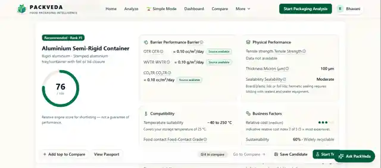
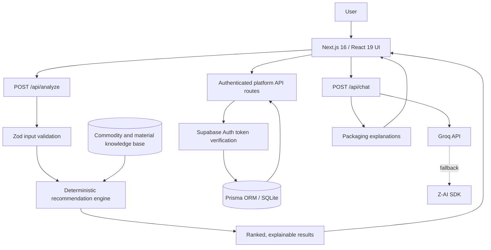

# PackVeda
### AI-Assisted Food Packaging Intelligence Platform

**Smarter Packaging. Safer Food. Longer Shelf Life.**

PackVeda is a food-packaging decision-support platform developed for **Smart India Hackathon 2026 — Problem Statement 26236**. It helps food businesses translate food characteristics, storage conditions, logistics and business priorities into an explainable shortlist of potentially suitable packaging materials.

> PackVeda is a hackathon prototype and decision-support tool. Its scores are relative shortlisting indicators, not guarantees of shelf life, food safety, regulatory compliance or commercial performance.

[Live Demo](https://packveda-sih-2026.space-z.ai) · [GitHub Repository](https://github.com/vaarunik/Packveda-SIH-2026)

## The Problem

Packaging selection depends on more than the food category. Moisture, fat, pH, water activity, respiration, oxygen and aroma sensitivity, storage conditions, transport and target shelf life all influence packaging requirements. Assessing these factors separately can make it difficult to compare materials, understand trade-offs and identify what needs supplier or laboratory verification.

## The Solution

PackVeda combines guided food-profile analysis, packaging-material shortlisting, explainable compatibility checks and buyer–seller workflows. Users enter product and distribution details, review derived packaging requirements, compare candidate materials and record shortlisted options and trials.

## Application Preview

### Dashboard


### Guided packaging analysis


### Recommendation results


## How It Works

1. **Food profile** — Select a commodity from the knowledge base or define a custom food.
2. **Composition** — Enter moisture, fat, pH, water activity and relevant food sensitivities.
3. **Storage** — Specify storage type, temperature and relative humidity.
4. **Logistics** — Describe transport duration and mode, handling intensity and light exposure.
5. **Priorities** — Set relative importance for cost, sustainability, barrier performance, shelf life and mechanical protection.
6. **Analysis** — Derive packaging requirements, evaluate material candidates and review explainable results.

## Key Features

- Six-step analysis with Simple and Expert modes and demo scenarios.
- Deterministic, rule-based material recommendations.
- Compatibility checks involving OTR, WVTR, CO₂ transmission, sealing, physical and temperature properties where data is available.
- Explainable scores, matches, gaps and exclusion reasons.
- Material comparison with normalized property profiles and side-by-side tables.
- Saved candidates, packaging passports and trial/validation tracking.
- Buyer–seller workflows, supplier material listings and sample or quote requests.
- Evidence and source provenance associated with analysis results.
- A separate AI assistant for packaging explanations and interpreting results.

## Recommendation Engine

The recommendation engine is deterministic and rule-based. It does **not** call an LLM and does not invent material property values.

```text
User inputs
   ↓
Requirement derivation (food-science rules)
   ↓
Hard-constraint filtering
   ↓
Multi-criteria scoring
   ↓
Ranked candidates + explanations
```

The engine derives requirements from the food profile and storage/logistics conditions, filters candidates against constraints, then scores remaining candidates using weighted dimensions such as barrier performance, shelf-life suitability, mechanical performance, cost, sustainability and availability. The separate matching layer checks material properties against individual requirements. Missing property values are surfaced as **unverified**, not guessed.

## Technical Architecture



The recommendation engine and AI assistant are separate components: the engine calculates deterministic compatibility results, while the assistant explains concepts and interprets supplied context. The assistant is instructed not to invent material values, certifications, supplier details or test outcomes.

## Technology Stack

| Layer | Technologies |
|---|---|
| Framework | Next.js 16, React 19, TypeScript 5 |
| Styling and UI | Tailwind CSS 4, Radix UI, shadcn/ui |
| Interaction and visuals | Framer Motion, Lucide React, Recharts |
| State management | Zustand |
| Forms and validation | React Hook Form, Zod |
| Backend | Next.js Route Handlers |
| Authentication | Supabase Auth / Supabase JavaScript client |
| Database access | Prisma ORM 6 |
| Database provider | SQLite |
| AI assistant | Groq API, Z-AI Web Dev SDK fallback |
| Package manager | Bun |

## Project Structure

```text
Packveda-SIH-2026/
├── prisma/schema.prisma
├── public/
├── src/
│   ├── app/api/
│   │   ├── analyze/  ├── analyses/  ├── chat/
│   │   ├── profile/  ├── requests/  ├── saved/
│   │   ├── supplier-materials/  └── trials/
│   ├── components/
│   └── lib/
│       ├── data/
│       ├── db.ts
│       ├── engine.ts
│       ├── evidence.ts
│       ├── matching.ts
│       ├── server-auth.ts
│       └── store.ts
├── package.json
└── next.config.ts
```

## Run Locally

### Prerequisites
- Node.js compatible with the installed Next.js version
- Bun
- A Supabase project for authentication
- A configured SQLite database

### 1. Clone and install

```bash
git clone https://github.com/vaarunik/Packveda-SIH-2026.git
cd Packveda-SIH-2026
bun install
```

### 2. Configure environment variables

Create `.env.local` in the project root:

```env
NEXT_PUBLIC_SUPABASE_URL=your_supabase_project_url
NEXT_PUBLIC_SUPABASE_ANON_KEY=your_supabase_anon_or_publishable_key
DATABASE_URL=your_sqlite_connection_string
GROQ_API_KEY=your_groq_api_key
GROQ_MODEL=openai/gpt-oss-120b
```

The Supabase URL and public anon/publishable key are used by the Supabase client and server-side token verification. Configure `DATABASE_URL` for your SQLite environment. `GROQ_API_KEY` enables the primary Groq assistant provider; the chat route includes a Z-AI SDK fallback. Never commit real credentials.

### 3. Generate Prisma client and prepare the database

```bash
bun run db:generate
bunx prisma db push
```

### 4. Start the development server

```bash
bun run dev
```

Open [http://localhost:3000](http://localhost:3000).

## Data Integrity, Limitations & Validation

- Built-in material properties are indicative, literature-typical values for material classes, not certified measurements of a specific supplier product.
- Actual barrier performance varies with grade, thickness, coatings, structure and test conditions. Verify supplier datasheets and test methods.
- Missing material values are treated as unavailable or unverified.
- Recommendation scores are relative shortlisting indicators, not measured shelf-life predictions.
- Regulatory checks and source records do not constitute certification or legal approval.
- Laboratory testing, food-contact verification, packaging trials and expert review are required before commercial adoption.
- Supplier-entered material properties are seller-declared and require independent verification.

## My Contributions

My contributions focused on research, product thinking and user experience:

- Researched food-packaging materials, food characteristics and packaging requirements.
- Contributed to defining product scope, features and prioritisation.
- Helped shape product flow and user journeys across analysis, recommendations and comparison.
- Adapted an existing interface template to PackVeda's use cases.
- Established the green-and-cream colour direction and maintained visual consistency across key screens.
- Contributed to solution presentation and documentation.

## Future Scope

- Expand commodity and material knowledge bases with independently verified data.
- Integrate supplier datasheets and laboratory-tested material properties.
- Strengthen product-specific validation and packaging trial workflows.
- Improve sustainability assessment using lifecycle and end-of-life data.
- Expand supplier verification and procurement workflows.

## Project Information

- **Project:** PackVeda
- **Hackathon:** Smart India Hackathon 2026
- **Problem Statement:** 26236
- **Focus:** AI-assisted food packaging material recommendation

---

**PackVeda — Smarter Packaging. Safer Food. Longer Shelf Life.**
